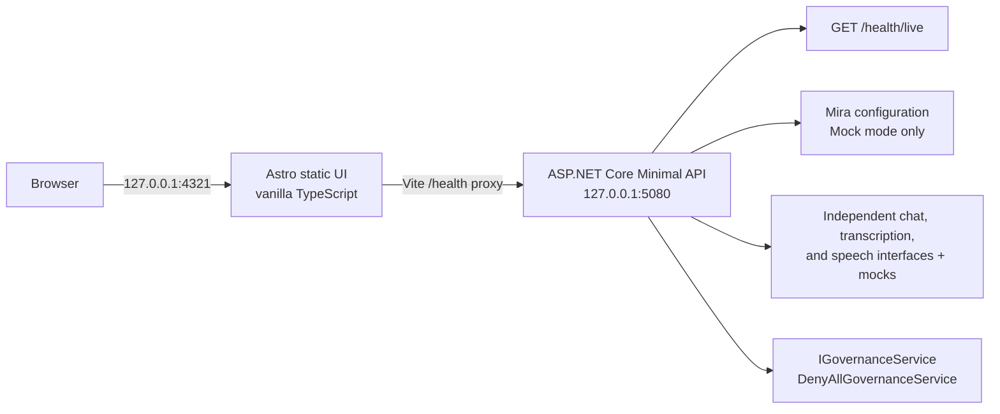

# M0 architecture and local development boundaries

> **Status:** Implemented M0 baseline, under review. The approved product design and later milestones remain in [STT3_HANDOFF.md](STT3_HANDOFF.md).

M0 provides a local shell for MIRA (Memory, Intelligence, Reasoning & Autonomy). The Astro page displays API availability; the ASP.NET Core Minimal API exposes only `GET /health/live`, which returns `{"status":"ok"}`. The projects build and test without provider credentials, model calls, or private user data.

## Implemented boundaries

- **Frontend:** `frontend/` is an Astro static project using vanilla TypeScript. Its status control fetches `/health/live`, validates the response, and offers a retry button. In development, Vite proxies `/health` to the API, so the browser uses the frontend origin. No chat or voice interaction is exposed.
- **Backend:** `backend/Mira.Api` targets .NET 10 and registers the health route. `LocalBindingPolicy` binds Kestrel explicitly to IPv4 loopback `127.0.0.1:5080`. Startup rejects `Kestrel:Endpoints`, any other `urls` value, and `HTTP_PORTS` or `HTTPS_PORTS`; it replaces Kestrel's endpoint configuration loader with an empty, non-reloading source. Allowed Host values are `localhost` and `127.0.0.1`. The health response contains no configuration, secrets, or user data. The API does not yet expose authentication, model, action, or data endpoints.
- **Provider seams:** `Mira.Core` defines separate `IChatProvider`, `ITranscriptionProvider`, and `ISpeechProvider` contracts. `Mira.Infrastructure` supplies deterministic mocks that honor cancellation. The `Mira:ProviderMode` option accepts only `Mock` and rejects other values at startup.
- **Governance:** `IGovernanceService` is registered with `DenyAllGovernanceService`, which rejects every capability request. No route or provider calls it in M0, and no model can grant itself permissions. Before agent tools are added, the contract must gain authenticated owner context, typed actions, and an audit path, as noted in Claude's M0 review. `whoami.md` remains persona material; administrator-controlled governance is a separate policy boundary.
- **Private data:** The Git ignore rules cover private local configuration, SQLite files, `data/`, `node_modules`, and build output. Provider keys, conversation data, persona overrides, audio, and any logs containing private text must stay outside source control. SQLite migrations and owner-scoped records belong to later milestones.

## Local development and review

From the repository root in Windows CMD, run `cd frontend`, `npm ci`, `cd ..`, then `scripts\dev.cmd`. It starts the API at `http://127.0.0.1:5080/health/live` and the frontend at `http://127.0.0.1:4321/`. Run `scripts\test.cmd` for the .NET build and tests, Astro checks, and static build. Neither script requires PowerShell. The README has the same tested setup sequence.

The API reads its standard configuration, optional private `backend\Mira.Api\appsettings.Local.json`, environment variables (including `MIRA_`-prefixed ones), then command-line arguments. The explicit prefixed override for provider mode is `MIRA_Mira__ProviderMode=Mock`. M0 has no database or paid provider dependency. The 12 passing tests cover option validation, default-deny governance, deterministic mocks, cancellation, the health route, foreign Host rejection, and startup rejection of unsupported provider and binding settings. One test launches the real API process and verifies it exits when a Kestrel endpoint requests `0.0.0.0:5081`.

Claude's independent M0 review and Codex's resolution evidence belong in the append-only `REVIEW.md`. Authentication and streamed chat begin in M1; conversation persistence, persona editing, memory, audio, and Tavily follow the milestone sequence in the handoff.
