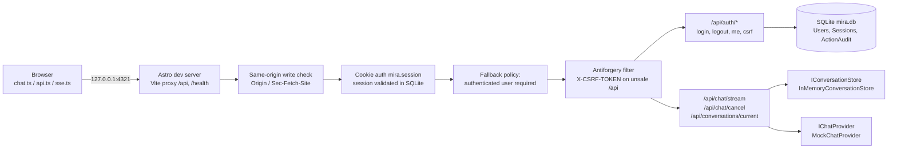

# M1 authentication and chat streaming

> **Status:** Implemented and reviewed M1. The approved product design and later milestones remain in [STT3_HANDOFF.md](STT3_HANDOFF.md); the M0 boundaries in [M0_ARCHITECTURE.md](M0_ARCHITECTURE.md) still apply.

## 1. Overview

M1 adds local username/password sign-in, server-side sessions, CSRF and origin protection, and a streamed text chat backed by the deterministic mock chat provider. The API still binds only to `http://127.0.0.1:5080`; `Mira:ProviderMode` still accepts only `Mock`. Accounts, sessions, and audit records live in SQLite; conversations live in process memory until M2.



The middleware order in `MiraHost.MapMiraEndpoints` is: same-origin write check, authentication, authorization, rate limiter, then endpoints. The CSRF check is an endpoint filter on the whole `/api` group.

## 2. Authentication and sessions

- **Account bootstrap:** no default credentials exist. `scripts\create-user.cmd <name>` runs the API project with `create-user --username <name>` (`AccountCommands.cs`), prompts twice without echo, and creates the account in the configured database. With redirected input, or `--password-stdin`, it reads one line from standard input as UTF-8.
- **Usernames:** trimmed, NFC-normalized, 1–64 characters of letters, digits, `.`, `_`, `-`, `@` (`UsernameRules`). Uniqueness and lookup use an upper-invariant `NormalizedUsername`, so names are case-insensitive.
- **Passwords:** NFC-normalized (`PasswordRules.Normalize`), never trimmed or truncated, length `Mira:Auth:MinimumPasswordLength`–`MaximumPasswordLength` (defaults 8–1024; the maximum may not be set below 128, so 35+ character passphrases always work). Hashed with ASP.NET Core Identity `PasswordHasher<T>` (PBKDF2, HMAC-SHA512, salted, versioned); hashes needing an upgrade are rehashed on successful sign-in. No strength checker.
- **Credential checks** (`SqliteUserAccountService.VerifyCredentialsAsync`) return `null` for unknown users, wrong passwords, and disabled accounts alike. Unknown users and over-long passwords are verified against a dummy hash so they take about the same time as a wrong password. The endpoint returns the same `401 Invalid username or password.` for all of them. Request bodies and passwords are never logged.
- **Session cookie:** `mira.session`, `HttpOnly`, `SameSite=Strict`, `Secure` when the request is HTTPS (`CookieSecurePolicy.SameAsRequest`), sliding expiry equal to the idle timeout. Unauthenticated API calls get a bare `401` (no redirect); forbidden ones get `403`.
- **Server-side sessions** (`SqliteSessionStore`): each sign-in creates a random 32-byte token (Base64url). The cookie carries it as a claim; the `Sessions` table stores only its SHA-256 hash, so a copied database cannot forge cookies. Every request revalidates the session (`OnValidatePrincipal`): unknown, revoked, absolutely expired (`SessionAbsoluteHours`, default 12), idle (`SessionIdleMinutes`, default 30), or belonging to a disabled user means the cookie is rejected and cleared. `LastSeenAt` is updated at most once per minute. An idle session is revoked when detected.
- **Login and logout:** every successful sign-in revokes any session the caller already carried and issues a new one. Logout revokes the session row server-side, so a replayed cookie fails afterward. The frontend shows the sign-in screen only after the server confirms the logout, or answers `401` because the session had already ended. If the API is unreachable or the request fails, the user stays signed in and is told so. A `403` (a stale CSRF token) is retried once with a fresh token.
- **Throttling:** `LoginThrottle` counts failures per normalized username, including unknown usernames, so lockout does not reveal which accounts exist. After `MaxFailedLoginsPerUsername` (default 5) failures within `FailedLoginWindowMinutes` (default 15, measured from the first failure), sign-in for that username returns `429 Too many failed attempts. Try again later.` even with the right password, until the window passes. A success resets the counter. Separately, a fixed-window rate limiter allows `LoginRequestsPerMinute` (default 20) sign-in requests per minute per remote IP address and answers excess requests with `429 Too many sign-in attempts. Wait a minute and try again.`
- **Default deny:** the authorization fallback policy requires an authenticated user on every endpoint unless it opts out with `AllowAnonymous()`. Only `/health/live`, `/api/auth/csrf`, and `/api/auth/login` are anonymous. Resource owner IDs always come from the authenticated principal (`CurrentUser.GetUserId`), never from request bodies.

## 3. CSRF and origin checks

- **Antiforgery tokens:** `GET /api/auth/csrf` returns `{"csrfToken": "..."}` and sets the `mira.csrf` cookie (`HttpOnly`, `SameSite=Strict`, `Secure` under HTTPS). Every unsafe request (anything but GET, HEAD, OPTIONS, TRACE) under `/api`, including login, must send the token in the `X-CSRF-TOKEN` header, or it gets `403 CSRF validation failed.`
- **User-bound tokens:** antiforgery tokens are bound to the signed-in identity, so a token fetched before sign-in is rejected afterwards. Login and logout responses therefore include a fresh `csrfToken`, which the frontend stores. On a `403` during sign-in the frontend refetches a token.
- **Same-origin writes** (`RequestSecurity.UseSameOriginWrites`, applied to the whole app): an unsafe request is refused with `403 Cross-origin request refused.` when `Sec-Fetch-Site` is `cross-site`, or when an `Origin` header is present and not in `Mira:AllowedOrigins` (default `http://127.0.0.1:4321`, `http://localhost:4321`, `http://127.0.0.1:5080`, `http://localhost:5080`). Requests without an `Origin` header (for example `curl`) still need a valid CSRF token.
- In development the Astro server proxies `/api` and `/health` (`frontend/astro.config.mjs`), so the browser sees a single origin and `SameSite=Strict` cookies are sent.

## 4. API

Error bodies are `application/problem+json` with a human-readable `title`, except the bare `401` from cookie authentication. Request bodies are limited to 256 KiB. JSON uses camelCase names and camelCase enum strings.

| Method | Path | Auth | CSRF | Success | Notable errors |
| --- | --- | --- | --- | --- | --- |
| GET | `/health/live` | Anonymous | No | `200 {"status":"ok"}` | `400` for a Host other than `localhost` / `127.0.0.1` |
| GET | `/api/auth/csrf` | Anonymous | No | `200 {"csrfToken"}`, sets `mira.csrf` | — |
| POST | `/api/auth/login` | Anonymous | Yes | `200 {"user":{"id","username"},"csrfToken"}`, sets `mira.session` | `401` invalid credentials (generic), `403` CSRF/origin, `429` username lockout or per-IP limit |
| POST | `/api/auth/logout` | Required | Yes | `200 {"csrfToken"}`, session revoked | `401`, `403` |
| GET | `/api/auth/me` | Required | No | `200 {"id","username"}` | `401` |
| GET | `/api/conversations/current` | Required | No | `200 {"id","messages":[{"id","role","content","status","createdAt","modelId"}]}` | `401` |
| POST | `/api/chat/stream` | Required | Yes | `200 text/event-stream` (section 5); body `{"message": "..."}` | `400 A message is required.` (missing/whitespace), `400 Messages are limited to 8000 characters.` (`Mira:Chat:MaxMessageLength`), `401`, `403`, `409 A response is already streaming. Wait for it to finish or stop it.` |
| POST | `/api/chat/cancel` | Required | Yes | `200 {"cancelled": true\|false}` | `401`, `403` |

M1 keeps one conversation per user; `/api/conversations/current` creates it on first use. `role` is `user` or `assistant`; `status` is described in section 5.

## 5. Streaming event contract

This is a public interface. `POST /api/chat/stream` answers with `Content-Type: text/event-stream; charset=utf-8`, `Cache-Control: no-cache, no-transform`, and `X-Accel-Buffering: no`, and flushes after every event (`SseWriter`). Each event is one `event:` line, one `data:` line holding a JSON envelope, and a blank line:

```text
event: response.delta
data: {"v":1,"requestId":"3f2c9a0d6b7e4c1f8a5b2d9e0c4f7a1b","conversationId":"6d1f0c2e-8a4b-4e7d-9c3a-1b2e5f7a9d0c","type":"response.delta","timestamp":"2026-10-17T00:00:00.123+00:00","data":{"text":"MIRA "}}

```

| Envelope field | Meaning |
| --- | --- |
| `v` | Schema version, currently `1`. |
| `requestId` | Per-turn ID (32 hex characters), also used in server logs. |
| `conversationId` | The user's conversation GUID. |
| `type` | Event type; matches the `event:` line. |
| `timestamp` | Server time (ISO 8601 with offset) when the event was written. |
| `data` | Event-specific object, below. |

| Event | When | `data` fields |
| --- | --- | --- |
| `response.started` | First event of every accepted turn | `messageId` (assistant message), `userMessageId`, `model` (`mock-chat`) |
| `response.delta` | Each chunk from the provider, in order | `text` |
| `response.completed` | Provider finished; message saved `completed` | `messageId`, `status` (`completed`), `firstTokenMs` (ms to first delta, may be `null`), `totalMs` |
| `response.cancelled` | `POST /api/chat/cancel` stopped the turn | `messageId`, `status` (`interrupted`) |
| `response.error` | Provider failure or timeout | `messageId`, `status`, `code`, `message` |

`response.error` codes:

- `provider_error`: the provider threw. Status `failed`; message `The model provider failed to complete the response.` Only the exception type is logged, since provider messages may echo conversation content.
- `timeout`: the turn ran longer than `Mira:Chat:MaxResponseSeconds` (default 120). Status `interrupted`; message `The response took too long and was stopped.`
- `conversation_deleted` (added in M2): the conversation was permanently deleted while the turn was running. Status `interrupted`; message `This conversation was deleted, so the reply was discarded.` Sent instead of `response.completed`, `response.cancelled`, or another error, and no pipeline events of that request are kept.

Behavior:

- **Client abort:** if the browser aborts the fetch (the UI's Stop button and Esc do this), the provider is cancelled, the partial text is saved with status `interrupted`, and no further event is sent, since nobody is listening.
- **One in-flight turn per user** (`ActiveTurnRegistry`): a second send while one is streaming gets `409` before any stream starts. `/api/chat/cancel` cancels the caller's own active turn and returns `cancelled: false` when there is none. Since M2, deleting the conversation also cancels its active turn and frees the slot.
- **Message statuses:** `streaming` (assistant message created when the turn starts), then exactly one of `completed`, `interrupted`, or `failed`. User messages are stored as `completed`. The backend owns persistence; partial output is never shown as completed.
- **Prompt context:** each turn sends all user messages plus only `completed` assistant replies, oldest first. Interrupted and failed assistant text is excluded from later prompts.
- **Mock provider:** `MockChatProvider` streams `MIRA mock response to "<your message, up to 60 text elements>". No model was called.` word by word with `Mira:Chat:MockDelayMilliseconds` (default 40) between words. A message containing `[mock-error]` makes it fail after the first delta, which exercises the `provider_error` path.
- `search.*`, `transcription.*`, and `speech.*` events from the handoff are not emitted in M1.

## 6. Data

`MiraDatabase` opens the SQLite file at `Mira:DatabasePath` (default `%LOCALAPPDATA%\MIRA\mira.db`, outside the repository), with foreign keys on and WAL journaling. On API startup and before `create-user`, `MigrateAsync` applies pending migrations.

Migration 1 creates:

| Table | Columns |
| --- | --- |
| `Users` | `Id`, `Username`, `NormalizedUsername` (unique), `PasswordHash`, `CreatedAt`, `DisabledAt` |
| `Sessions` | `Id` (SHA-256 hash of the token), `UserId` (FK `Users`, cascade delete), `CreatedAt`, `LastSeenAt`, `ExpiresAt`, `RevokedAt`; index on `UserId` |
| `ActionAudit` | `Id`, `OwnerUserId`, `GrantId`, `Capability`, `Action`, `ResourceScope`, `Decision` (`Allowed` / `Denied`), `RedactedSummary`, `CreatedAt`; index on (`OwnerUserId`, `CreatedAt`) |

`SchemaMigrations` (`Version`, `AppliedAt`) is created outside the numbered migrations and records each applied version. Migrations are an append-only list of versioned SQL scripts, each applied in its own transaction; an applied migration is never edited. Data access uses `Microsoft.Data.Sqlite` with parameterized commands. EF Core migrations are deferred; see [decision 0001](decisions/0001-sqlite-access-without-ef-core.md).

Conversations are held by `InMemoryConversationStore`, keyed by owner, and are lost when the API restarts. Every store method takes the owner ID; there is no lookup by bare conversation ID. M2 replaces it with SQLite persistence.

## 7. Governance

The contract from M0 was expanded as Claude's M0 review required:

- `CapabilityRequest(OwnerUserId, Capability, Action, ResourceScope)`, where `OwnerUserId` must come from the authenticated principal and `Action` is the typed `ActionClass` (`Read`, `Write`, `Delete`, `Execute`).
- `GovernanceDecision(Allowed, Reason, GrantId)`.
- `IGovernanceService.EvaluateAsync` is asynchronous, and implementations must audit every decision through `IGovernanceAuditLog`, implemented by `SqliteGovernanceAuditLog` writing to `ActionAudit`.

`DenyAllGovernanceService` still denies everything (`No capabilities are enabled.`) and records each denial. No endpoint or provider calls it in M1, and no grant mechanism exists.

## 8. Frontend

| Module | Responsibility |
| --- | --- |
| `src/pages/index.astro` | Markup and styles: status header, sign-in form, chat view (message log, composer, Stop/Send), status announcer |
| `src/scripts/health.ts` | Polls `/health/live` for the **API online / unavailable** indicator, with a **Check again** button |
| `src/scripts/api.ts` | Same-origin `fetch` helpers; keeps the CSRF token and sends it as `X-CSRF-TOKEN` on every POST; turns problem responses into `ApiError` using their `title` |
| `src/scripts/chat.ts` | Startup (`/api/auth/csrf`, then `/api/auth/me`), sign-in/out, loading the current conversation, sending, streaming, Stop/Esc, status display |
| `src/scripts/sse.ts` | Incremental SSE parser and `readSse` reader over the fetch body |
| `src/scripts/sse.test.ts` | Vitest tests for the parser |
| `src/scripts/session.ts` | Sign-out logic: reports success only once the server has revoked the session |
| `src/scripts/session.test.ts` | Vitest tests for sign-out success and failure paths |

- **Safe rendering:** user and model text is assigned only with `textContent`; nothing is parsed as HTML. Markdown is not rendered.
- **Stream parsing:** `SseParser` handles lines, events, and CRLF pairs split anywhere across chunks, LF/CR/CRLF line endings, comments, multi-line `data`, and the default `message` event name, and discards an unterminated final event. `readSse` uses a streaming `TextDecoder` so multi-byte UTF-8 characters split across chunks decode correctly. The tests cover each of these.
- **Refused sends:** if the stream request is rejected before it starts (`400`, `409`, `403`), the optimistic message bubbles are removed and the draft is kept; a `401` returns to the sign-in form with `Your session ended. Sign in again.`
- **Accessibility:** the message list is `role="log"`; a streaming assistant message and the composer carry `aria-busy`; a visually hidden `role="status"` live region announces "MIRA is responding." and the outcome; errors use `role="alert"`; the header status is a polite live region. Keyboard: Enter sends, Shift+Enter adds a new line (IME composition is respected), Esc stops a streaming response; focus returns to the composer after each turn and moves to the first empty sign-in field when the form appears. Focus outlines are visible.

## 9. Tests

`scripts\test.cmd` runs the xUnit tests (`AuthTests`, `ChatStreamTests`, `StoreTests`, `ApiHostTests`, `M0BoundaryTests`) and the Vitest tests for the parser and sign-out. They cover the M1 acceptance criteria: unauthenticated API access denied, a long Unicode passphrase (at least 35 characters) that is neither trimmed nor truncated, generic responses for wrong passwords and unknown users, disabled accounts, passwords absent from logs, CSRF on login and authenticated writes, rejection of pre-login tokens after login, cross-origin refusal, username lockout and per-IP rate limiting, server-side logout revocation, a new session per login, cookie flags, idle and absolute session expiry, hashed session tokens, salted password hashes, idempotent migrations, audited governance denials, ordered deltas, client abort marking the turn `interrupted`, explicit cancel, provider failure, timeout, the `409` on competing sends, message validation, owner scoping (including an owner ID smuggled into the body), prompt context excluding interrupted replies, piped UTF-8 passwords for `create-user`, and a sign-out that never claims success while the server session is still valid.

## 10. Known limits and deferred work

- Conversations are in memory and lost on restart; persistence and the conversation inspector are M2.
- No real chat provider: `Mira:ProviderMode` accepts only `Mock`. The Azure chat provider is deferred and needs owner approval because it is a paid service.
- HTTP on loopback only. Cookies become `Secure` only when served over HTTPS; remote deployment needs TLS and a threat review (M8).
- No Markdown rendering yet; text is shown as plain text.
- No account recovery, password change, or account-disable command. `IUserAccountService.SetDisabledAsync` exists but is only used by tests.
- The username lockout counter is in memory: an API restart clears it. The per-IP rate limit is effectively shared by everything behind the Astro proxy, since all proxied requests come from `127.0.0.1`.
