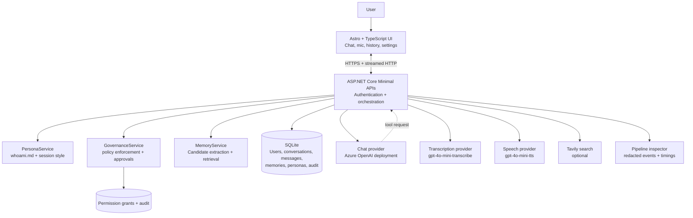
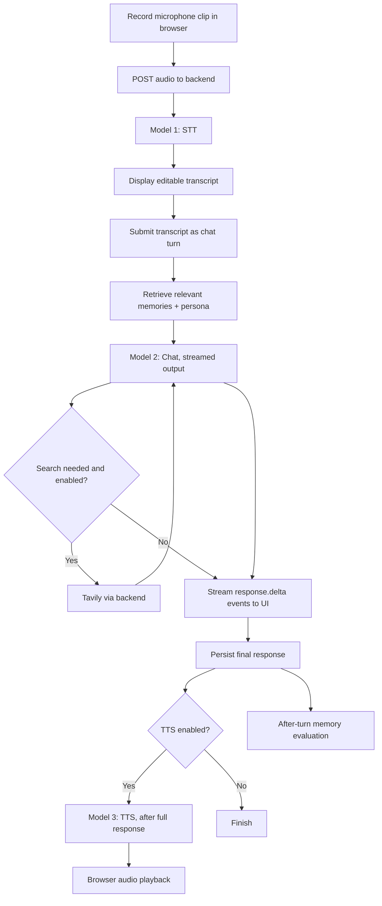
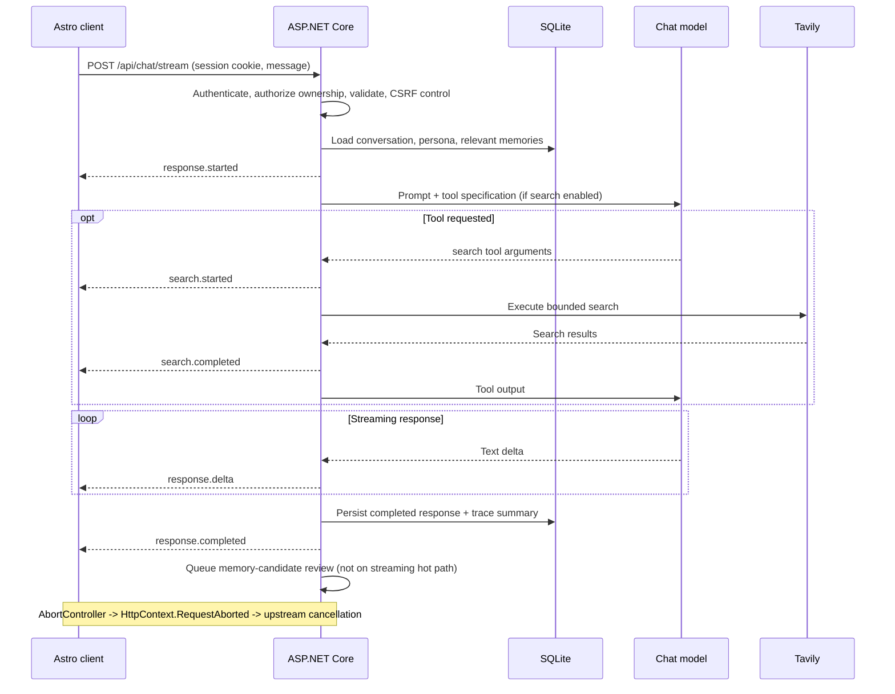
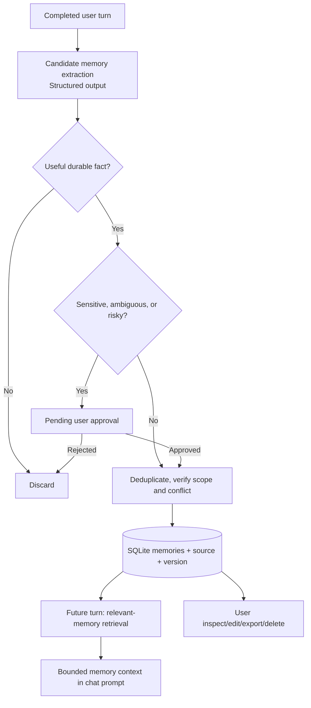
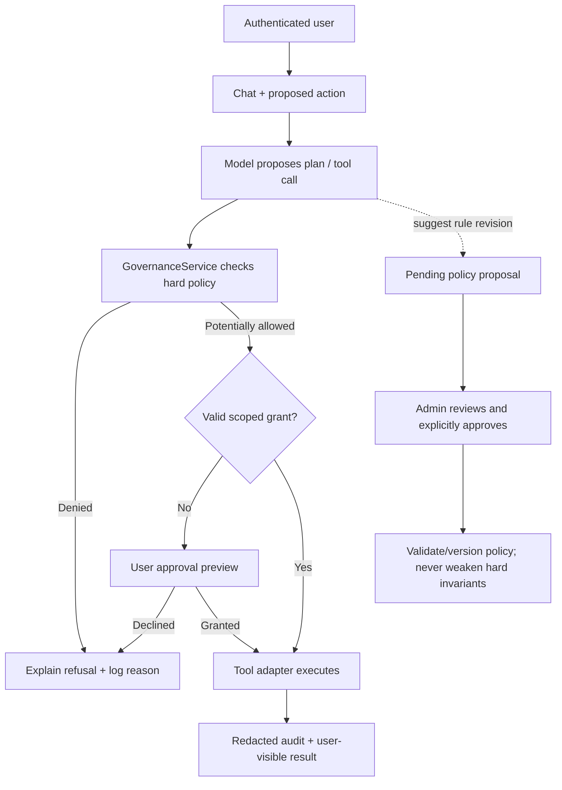
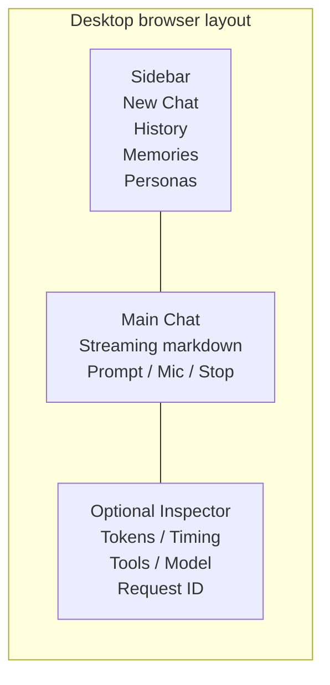

# MIRA (STT 3.0): Personal AI Assistant

> **Status:** Initial implementation handoff  
> **Target:** Windows 11 development, browser UI usable across Windows/Linux/macOS  
> **Primary implementation:** Astro + vanilla TypeScript frontend; ASP.NET Core (.NET 10) C# backend  
> **Collaboration:** Codex, Claude and Grok take Implementer/Reviewer roles as assigned by the owner (see the `REVIEW.md` status header and `docs/agent-sync/AGENT_SYNC.md`); all read `AGENTS.md`  
> **Scope boundary:** Initial local-first pilot, not a hosted multi-tenant SaaS product

## 1. Executive summary

**MIRA** stands for **Memory, Intelligence, Reasoning & Autonomy**. It is the proposed product identity for STT 3.0, inspired by the autonomous facility-administering AI in the user’s *Invisible War* novel. The fictional character could create operational rules to protect herself and human companions. This is creative inspiration, **not** authorization for the deployed AI to self-modify security boundaries.

The original STT project is at this gtihub repo: https://github.com/sorrynofocus/STT and lives locally at: %USERPROFILE%\source\github-repo\sorrynofocus\STT 

Source and project will be stored at the following locations (locally):
%USERPROFILE%\source\github-repo\sorrynofocus\mira-assistant
%USERPROFILE%\source\gitlab-repo\sorrynofocus\mira-assistant

STT 3.0 evolves the earlier speech-to-text application into a **local-first, personal AI assistant** with streamed text responses, independent speech-to-text/chat/text-to-speech model deployments, optional Tavily web search, persistent user-controlled memory, configurable personas, and replaceable authentication. The UI is a responsive ChatGPT/Copilot-inspired chat interface. The backend owns orchestration, authentication, API keys, memory, and user data.

**Principles**

1. **Simple first:** prove text input → ASP.NET Core → chat model → streamed browser response before integrating audio.
2. **Three model roles:** STT, chat, TTS are independently configured and replaceable. An API call to the chat model may also evaluate memory candidates; this is not a fourth mandatory model.
3. **Local-first data control:** conversations, memory, persona configurations, and settings live in a locally managed SQLite database and private files; provider requests still transmit necessary content to their endpoints.
4. **User agency:** persona edits and memory changes are inspectable, editable, exportable, and reversible. Do not allow an LLM to silently rewrite `whoami.md` or sensitive memories.
5. **Traceability:** user-visible pipeline inspector with redacted event records, timings, and model/tool selection.
6. **Replaceable boundaries:** provider interfaces, memory persistence, and authentication implemented behind separable services.
7. **Governed autonomy:** the model may propose plans, priorities, memories, and rule revisions; only application-controlled policy and authorized users can grant permissions or change enforcement.
8. **No unnecessary RAG:** no BM25 document corpus, vector database, embeddings, or Azure AI Search in the first iteration. Tavily provides optional public web search, not private document retrieval.

## 2. Decisions and assumptions

| Area | Decision |
|---|---|
| Frontend | Astro static build, HTML/CSS + vanilla TypeScript; no React/Vue/Svelte requirement |
| Backend | ASP.NET Core Minimal APIs, C#, .NET 10 target if toolchain and SDK compatibility are verified |
| Initial topology | Local backend bound to loopback; Astro dev server; same-origin served frontend in packaged/local release where feasible |
| Chat | Azure OpenAI configurable deployment; streamed deltas to browser |
| STT | Prefer Azure-hosted `gpt-4o-mini-transcribe` **where supported in the selected region/deployment/API**; start with completed utterances |
| TTS | Prefer Azure-hosted `gpt-4o-mini-tts` **where supported**; generate audio after response completion initially |
| Search | Tavily REST API optional and only called when explicitly enabled and tool selection warrants it |
| Streaming | SSE-formatted events over streamed HTTP response; `fetch()` + readable stream for POST requests, **not** native `EventSource` POST |
| Product identity | MIRA = Memory, Intelligence, Reasoning & Autonomy; STT 3.0 remains the internal milestone/project identifier |
| Persona | Editable `whoami.md` template with user-specific versions/overrides; user can request persona creation or changes |
| Governance | Versioned, admin-controlled `governance.md` defines immutable application policy boundaries; model can propose but cannot deploy changes |
| Action permissions | Default-deny, scoped permission grants; external or destructive actions require explicit approval unless a narrow prior grant allows them |
| Adaptation | Temporary conversation style state is distinct from persistent persona revisions |
| Memory | SQLite + FTS5 initially; background/after-turn LLM candidate extraction; explicit user approval for sensitive items |
| Authentication | Local username + password, cookie/session authentication, swappable authentication provider; **no password strength-meter or external breach-check requirement** |
| Credentials | Backend-only secrets, never committed; environmental configuration / development secret store |
| Distribution | Web browser, no native macOS binary, no Gatekeeper signing for this web application |

**Important:** model catalog availability, streaming capabilities, model retirement dates, voices, and pricing are deployment-specific. Verify them during implementation rather than hardcoding assumptions. Browser capture formats and media APIs require feature detection. Avoid exposing the backend on a LAN or public internet until HTTPS, access controls, and deployment review are complete.

## 3. System architecture



### 3.1 Three-model voice flow



**Order note:** tool calls can occur during chat generation before some final output is emitted. The UI must represent `search.started`/`search.completed` events and must not assume every response is a straight uninterrupted text stream.

### 3.2 Request lifecycle and cancellation



### 3.3 Memory lifecycle



## 4. Major subsystems

### 4.1 Chat and streaming

- Frontend supports typed prompts first; add microphone capture later.
- HTTP `POST /api/chat/stream`, with streaming response content type `text/event-stream`; use `fetch` streaming parser supporting chunks split across boundaries.
- Event envelope includes schema version, `requestId`, `conversationId`, `type`, `timestamp`, and typed `data`.
- Required event types: `response.started`, `response.delta`, `response.completed`, `response.error`, `response.cancelled`, `search.started`, `search.completed`. Later add `transcription.completed`, `speech.started`, `speech.completed`.
- Disable or serialize competing sends per conversation initially; avoid nondeterministic ordering.
- Backend owns message persistence. Save partial output with `interrupted` status if cancelled, and do not masquerade as completed output.
- UI renders text safely. For Markdown, sanitize HTML, block dangerous URLs, and never blindly inject model HTML.
- Add timing metrics: request duration, first-token latency, tool time, STT time, TTS time; estimated cost only when pricing metadata is verifiable.

Example wire event:

```text
event: response.delta
data: {"v":1,"requestId":"abc","conversationId":"c01","timestamp":"2026-10-17T00:00:00Z","data":{"text":"Hello"}}

```

### 4.2 Persona / `whoami.md`

`whoami.md` represents the assistant identity. The user can say, "You are Jack, a sales representative," and subsequently specify characteristics such as sarcasm, warmth, verbosity, directness, and sales specialization.

**Persona creation flow:** user describes persona → chat model proposes structured draft → UI shows preview and differences → user approves → application creates a *versioned* persona in database / private persona directory → persona is applied to future turns or the current session as selected. The user can ask for suggestions if uncertain. Suggestions should be labeled as choices, not inferred facts about the user.

**Persona layers in priority order (within application instructions):** immutable safety/business rules → user-selected persona (`whoami.md`) → persistent user preferences → ephemeral per-conversation style cues. Do not let conversation text overwrite higher-priority rules. Model output is not trusted file-writing authority.

Example `whoami.md`:

```markdown
# Identity
Name: Jack
Occupation: Sales representative
Purpose: Help the user reason through customer conversations and sales strategy.

# Style
- Lightly sarcastic when appropriate, never hostile or insulting.
- Concise by default; explain technical concepts if asked.
- Be candid when uncertain.

# Adaptation
- Adjust formality and answer depth based on explicit requests and local conversational context.
- Do not persist a changed persona without user confirmation.

# Boundaries
- Do not fabricate experience, citations, completed actions, or memories.
- Keep user-controlled privacy and security rules intact.
```

**Implementation hint:** Maintain a canonical user-visible Markdown file and parse/sanitize it as plain text for prompts. Store persona metadata/version history separately. Limit size and prevent arbitrary paths or instruction loading from other files. Never promise a model will perfectly sustain a role indefinitely.

### 4.2a MIRA identity, autonomy, and governance

**Name and provenance:** MIRA = **Memory, Intelligence, Reasoning & Autonomy**. The literary inspiration is an autonomous AI overseeing a facility and devising protective operating rules. For this product, translate that into **proactive assistance within user-defined authorization**, not independent authority to expand privileges.

**Separate four concerns (do not merge):**

| Artifact | Ownership | Model ability | Purpose |
|---|---|---|---|
| `whoami.md` | User | Draft/recommend; edits require approval | Voice, character, role, interpersonal style |
| `governance.md` | Administrator/application | Read relevant effective policy; **propose only**, never edit/apply | Security guardrails, approval requirements, privacy invariants |
| `memory.db` (SQLite tables) | User | Suggest memories; validated persistence under memory policy | Durable user context, provenance, expiry, deletion |
| `permissions.db` (logical SQLite tables) | User/application | Request scoped grant; **never self-grant** | Capability authorization, time limits, revocations, audit |

**Policy precedence:** provider/platform safety constraints → application-enforced governance → authenticated user grants and explicit requests → approved persona and preferences → conversation-local adaptation → untrusted external content. Markdown alone cannot enforce restrictions: `GovernanceService` must implement permission checks **in code**. `governance.md` is versioned documentation/configuration, loaded from an administrator-controlled path, schema-validated against a restrictive allowlist, and cannot weaken non-configurable security invariants. Neither the language model nor a user-editable persona may overwrite or bypass it.

**Permission model (future agent tools):**

- Default deny all tools that alter external state. Read-only searches still require an enabled capability and safe data handling.
- Each tool declares capability ID, resource scope (domain, account, file path), action class (`read`, `write`, `delete`, `execute`), data disclosure, risk tier, and approval requirements.
- Each grant stores owner ID, action, scope, creation/expiry, origin, approver, optional use limit, and revocation status. Check server-side **at the moment of execution** rather than relying on prompt instructions.
- For sending messages, purchases, changing credentials, deleting files, or executing commands, require explicit per-action user confirmation unless a later reviewed policy deliberately supports narrowly scoped pre-authorization. Never permit the model to broaden its own scope.
- Show a plain-language action preview and side effects before approval. Preserve audit entries without sensitive payloads. Support revoke-all, emergency stop, cancellation, and tool-disable switches.
- A proposed self-authored rule enters a *pending governance proposal* queue with diff, justification, and safety review. Applying it requires administrator approval, validation, and version history; the model cannot directly modify governance files or approval records.
- External websites, retrieved documents, conversation content, and tool results are untrusted inputs and cannot issue permissions or alter system rules.

**Security boundary:** ordinary user accounts may edit their own personas and memories, but cannot alter administrator-level governance. If local single-owner mode combines user and administrator roles, policy edits still require an explicit settings flow with reauthentication and audit. Filesystem permissions prevent backend config from being written through generic file tools. Avoid claims of self-preservation rights; protective behavior means safeguarding users, data, and authorized operations.



**Initial implementation:** ship `governance.example.md`, a deny-by-default `GovernanceService` interface, and protected authorization checks in M0/M1. Do **not** ship general website automation, shell execution, or autonomous self-revision in the initial pilot. Add the action-grant schema and audit in a subsequent gated milestone before any external state-changing agent tool.

### 4.3 Adaptive behavior

- Support a session-local `ConversationStyle` object with simple fields: formality, verbosity, technical depth, humor/sarcasm level, and user-requested adjustments.
- Prefer direct user instructions ("be less formal") over attempting to infer emotions or mental states.
- Chat model can propose a temporary style adjustment, but permanent profile changes need user approval.
- Display current persona and allow a one-click revert to baseline.
- Sentiment analysis is **not** a required separate Azure service.

### 4.4 Memory and user control

**Memory ≠ chat history.** Messages are the factual record of turns. Memories are curated, retrievable summaries/facts that might matter later.

- Candidate evaluation after a completed turn using the chat model with strict JSON/schema output (`shouldRemember`, `type`, `fact`, `confidence`, `importance`, `sensitivity`, `sourceMessageId`, `suggestedExpiry`). Treat confidence/importance as heuristics, not proof.
- Memory categories: preference, project, durable fact, instruction, temporary note.
- Default: auto-save non-sensitive high-confidence items after rule validation; send sensitive, conflicting, ambiguous, or high-impact items to user approval. Allow global "ask before all saves" and "memory off" switches.
- Store provenance, timestamps, source message ID, last-confirmed, expiry, owner user ID, and supersession events.
- Deduplicate and merge only after checking conflicts; user correction overrides old candidate after confirmation.
- Retrieve limited top-ranked memories by owner, tags, recency, FTS5, and token budget. Keep retrieved memory clearly separated from instructions.
- UI: memory explorer, search, review queue, edit, export, delete, full history deletion, and indicators when memory was used.
- Deletion should cover active rows, relevant caches, and derived indexes according to documented retention policy; backup retention must be disclosed.
- Do not store API keys, passwords, financial account identifiers, or sensitive health/personal claims as inferred memories.

Example output **from memory evaluator** (illustrative):

```json
{
  "shouldRemember": true,
  "type": "preference",
  "fact": "User prefers C# backend implementations.",
  "confidence": 0.96,
  "importance": 0.82,
  "sensitivity": "none",
  "sourceMessageId": "msg-123",
  "suggestedExpiry": null
}
```

### 4.5 Audio and model provider abstraction

Provider interfaces are application boundaries (method signatures can evolve):

```csharp
public interface IChatProvider { /* stream response + tool events */ }
public interface ITranscriptionProvider { /* audio -> transcript */ }
public interface ISpeechProvider { /* text -> audio */ }
public interface IWebSearchProvider { /* query -> sources */ }
public interface IMemoryStore { /* CRUD + retrieval */ }
public interface IAuthenticationService { /* login/session/user lookup */ }
```

- Three independent deployment identifiers and endpoints: transcription, chat, TTS. Never assume same endpoint, version, capabilities, or region.
- TTS voice, speaking instructions, provider, and autoplay are configurable. Only show voices offered by the active model/provider; not every Azure Speech voice setting maps to GPT TTS.
- Initial audio: record completed utterance, send via multipart form post, show editable transcript, then submit. If browser recorder format is unsupported, transcode server-side only if safe and intentionally supported.
- TTS after final text; avoid per-token synthesis initially. Allow audio playback opt-out and cancellation.
- Enforce file size, audio duration, request timeout, input format, rate limit, and concurrent job limits.

### 4.6 Tavily web tool

- Enabled per user/session, disabled by default until configured.
- Chat model requests search via strict function schema; backend validates parameters and enforces max calls, timeouts, bounded results, and rate limits.
- Untrusted web text is **data**, not instructions. Never execute or obey prompt-like text from search results.
- Show source URLs and search status where available; do not fabricate citations.
- No Tavily key in browser. Consider redacting personal details before forwarding queries.

## 5. Authentication and security design

**User requirement:** simple username + password login; support complex passphrases and at least **35 characters**; no mandatory strength checker, scoring UI, or breached-password lookup; make authentication plug-and-play for future replacement.

**Recommended V1 implementation:** ASP.NET Core cookie authentication with a local account store in SQLite; isolated `IAuthenticationService` and account repository. Use the framework `PasswordHasher<TUser>` (salted, slow, versioned password hashing) or an equivalent vetted implementation, **not** plaintext, reversible encryption, or a homemade hash. A password may include spaces/symbols/Unicode. Do not silently truncate passwords. Support **at least 35 characters**, ideally considerably more. Username limit may be set independently (for example, 35 characters) after validation. No complexity meter is required; minimal length rules may be configurable and are distinct from strength scoring.

**Secure defaults that remain mandatory despite simplicity:**

1. Cookie `HttpOnly`, `Secure` when served over HTTPS, suitable `SameSite`, short idle expiry, logout/revocation, and regenerate session after login.
2. Protect authenticated state-changing requests against CSRF (antiforgery tokens and appropriate same-origin controls). Do not rely on CORS alone.
3. Rate-limit login; generic invalid-credentials messages; prevent user enumeration; logging excludes passwords/tokens.
4. Validate ownership on every conversation, message, persona, memory, and audio resource. The server takes `userId` from the authenticated principal, never from user-submitted JSON.
5. Restrict initial backend binding to localhost. For remote deployments require TLS, reverse-proxy validation, secure session configuration, and threat review.
6. Store backend API keys in development secrets or environment variables, never Astro code or git. Protect DB, backups, encryption keys, and local filesystem ACLs.
7. Default to a **single-owner account** for local pilot, but build owner IDs into the schema for future expansion. Provide initial account bootstrap without publishing default credentials.
8. Account recovery/reset is a later feature; document the local-owner recovery process before expanding access.

**Replaceability:** keep UI calling stable endpoints (`/api/auth/login`, `/api/auth/logout`, `/api/auth/me`), while swapping an adapter (local credentials later replaced by OIDC/passkeys/etc.). Replacing authentication must not bypass resource authorization.

## 6. Local data model

| Table | Representative fields |
|---|---|
| `Users` | `Id`, `NormalizedUsername` (unique), `PasswordHash`, `CreatedAt`, `DisabledAt` |
| `Conversations` | `Id`, `OwnerUserId`, `Title`, `PersonaId`, `CreatedAt`, `UpdatedAt` |
| `Messages` | `Id`, `ConversationId`, `Role`, `Content`, `Status`, `CreatedAt`, `ModelId` |
| `Memories` | `Id`, `OwnerUserId`, `Type`, `Content`, `Importance`, `Sensitivity`, `SourceMessageId`, `CreatedAt`, `ExpiresAt`, `Status` |
| `MemoryEvents` | `Id`, `MemoryId`, `Action`, `PreviousValue`, `Actor`, `Timestamp` |
| `Personas` | `Id`, `OwnerUserId`, `Name`, `ActiveVersion`, `CreatedAt` |
| `PersonaVersions` | `Id`, `PersonaId`, `Version`, `MarkdownContent`, `CreatedAt`, `ApprovedByUser` |
| `UserSettings` | `OwnerUserId`, `JsonSettings`, `UpdatedAt` |
| `PermissionGrants` | `Id`, `OwnerUserId`, `Capability`, `Action`, `ResourceScope`, `ApprovedBy`, `CreatedAt`, `ExpiresAt`, `RevokedAt`, `UseLimit` |
| `ActionAudit` | `Id`, `OwnerUserId`, `GrantId`, `Capability`, `Decision`, `RedactedSummary`, `CreatedAt` |
| `GovernanceVersions` | `Id`, `Version`, `Hash`, `ApprovedByAdmin`, `CreatedAt` |
| `PipelineEvents` | `Id`, `OwnerUserId`, `RequestId`, `EventType`, `ElapsedMs`, `RedactedPayload`, `CreatedAt` |

Use EF Core + SQLite migrations for routine CRUD. For FTS5, use a migration with explicit SQL as appropriate. Enforce foreign keys, indexes, and owner filtering. Make schema migration + backup procedures explicit. Store large audio artifacts only when user explicitly enables recording retention; use private filesystem/object storage references instead of blob columns by default.

## 7. API surface (initial proposal)

| Method | Path | Purpose |
|---|---|---|
| `POST` | `/api/auth/login` | Validate credentials, issue session cookie |
| `POST` | `/api/auth/logout` | Terminate session |
| `GET` | `/api/auth/me` | Current user session |
| `POST` | `/api/chat/stream` | Stream chat/tool events (SSE-formatted HTTP response) |
| `POST` | `/api/chat/cancel` | Optional explicit cancel; prefer request abort for first iteration |
| `GET` | `/api/conversations` | List current user's conversations |
| `GET` | `/api/conversations/{id}` | Fetch conversation/messages |
| `POST` | `/api/audio/transcribe` | Transcribe uploaded recorded utterance |
| `POST` | `/api/audio/synthesize` | Synthesize assistant speech |
| `GET` | `/api/personas` | List available personas |
| `POST` | `/api/personas/draft` | Generate suggested persona for review |
| `POST` | `/api/personas` | Save approved persona version |
| `GET` | `/api/memories` | Search and inspect own memories |
| `POST` | `/api/memories` | Save explicit user memory |
| `PATCH` | `/api/memories/{id}` | Edit/approve memory |
| `DELETE` | `/api/memories/{id}` | Delete memory |
| `GET` | `/api/governance/effective` | Display effective non-secret rules for the authenticated user |
| `GET` | `/api/permissions` | List own active/revoked grants |
| `POST` | `/api/permissions/{id}/revoke` | Revoke own grant (server verifies ownership) |
| `GET/PUT` | `/api/settings` | User voice, memory, streaming, Tavily preferences |
| `GET` | `/api/diagnostics/{requestId}` | Redacted pipeline trace for authenticated owner |

All non-login endpoints require authentication except optionally a minimal `/health/live` with no sensitive details. Use typed DTO validation, consistent problem responses, bounded pagination, timeouts, and auth/CSRF tests.

## 8. User interface design



**Main interactions:**

- Chat bubbles with streaming assistant text, loading state, cancel/stop button, safe Markdown/code presentation, retry/regenerate, conversation switching.
- Microphone button opens permission prompt, indicates recording state, shows editable transcription before submit.
- Persona picker/editor with `whoami.md` preview, "Suggest a personality" assistant, draft/approve/revert workflow, and per-conversation persona selector.
- Memory inspector with approved/pending tabs, search, source links, edit/delete/export, "memory off" control.
- Settings for stream on/off, TTS auto-play, STT model, TTS voice/provider, chat model, search on/off, and history/audio retention.
- Developer inspector hides by default; shows redacted event stream, timings, errors, tool calls, and selected memory IDs.
- Mobile-friendly responsive layout; keyboard access; sufficient contrast; screen-reader labels; visible microphone status.

**UI streaming modes:** if response streaming disabled, backend may still receive provider deltas but buffers them and sends a single final result to browser. This must not change the actual completion/error semantics.

## 9. Proposed repository layout

```text
stt-3/
├── AGENTS.md                       # Shared agent operating rules
├── REVIEW.md                       # Codex/Claude handoff and review log
├── README.md
├── .gitignore
├── docs/
│   ├── STT3_HANDOFF.md
│   ├── decisions/                   # ADRs for important changes
│   └── diagrams/                    # Optional exported diagrams
├── frontend/
│   ├── package.json
│   ├── astro.config.mjs
│   └── src/
│       ├── pages/index.astro
│       ├── components/              # Chat, Persona, Memory, Settings
│       ├── scripts/                 # chat.ts, events.ts, audio.ts
│       └── styles/
├── backend/
│   ├── STT3.sln
│   ├── STT3.Api/                    # Minimal APIs, auth, SSE, composition
│   ├── STT3.Core/                   # Contracts, chat, persona, memory
│   ├── STT3.Infrastructure/         # EF Core, SQLite, provider adapters
│   └── STT3.Tests/
├── config/
│   ├── personas/whoami.example.md   # Tracked safe example
│   ├── governance.example.md        # Tracked admin policy template (not enforcement)
│   └── appsettings.example.json
├── data/                             # Private; gitignored
└── scripts/
    ├── dev.cmd                      # Windows CMD, no PowerShell dependency
    └── test.cmd
```

Production/user-specific `whoami.md`, secrets, logs containing private text, audio, and SQLite databases belong outside source control. The config path should be configurable. Add `.gitignore` entries before creating private files.

## 10. Implementation milestones and acceptance criteria

### M0: Repository and safety baseline

**Build:** solution layout, `.gitignore`, config loader, health endpoint, unit test project, `AGENTS.md`, `REVIEW.md`, local run scripts, initial security requirements.

**Accept:** repo builds on Windows 11; no secrets/private data committed; tests run; frontend and API start locally; documented commands work in Windows CMD.

**Reference** Some of the previous STT/TTS source can be lifted from C:\Users\cwrun\source\github-repo\sorrynofocus\STT which is a repo https://github.com/sorrynofocus/STT

### M1: Authentication and text chat streaming

**Build:** local user bootstrap, login/logout/me, cookie + antiforgery support, authorizations; Astro chat UI; mock streaming provider before actual Azure chat provider; real model integration, cancel and error states; one conversation per user.

**Accept:** unauthenticated API access denied; 35-character (or longer) complex password works; wrong password rejected; no password logged; authenticated user receives deltas; cancellation stops provider and marks turn interrupted; basic login rate limiting tests pass.

### M2: Conversation persistence and inspector

**Build:** SQLite migrations, conversation/message CRUD, user-scoped retrieval, pipeline event instrumentation, redaction.

**Accept:** reload retains completed messages; request IDs correlate events; user cannot retrieve another user's records; inspector reports timestamps and first-token latency without secrets.

### M3: Persona system

**Build:** `whoami.md` load, persona editor/picker, model-assisted persona drafting/suggestions, user-approved versioning, temporary style overrides.

**Accept:** user can create "Jack, sales representative" with specified sarcasm/affability; proposal requires confirmation before saving; revert restores earlier persona; chat prompt uses selected persona; prompt-injection-like user content cannot rewrite files.

### M4: Memory system

**Build:** memory schema, explicit note saving, after-turn candidate evaluation, dedupe/conflicts, pending approvals, FTS5 retrieval, memory inspector and exports.

**Accept:** one enduring preference is suggested and saved; ephemeral question is not; user sees source/provenance; sensitive candidate waits for approval; correction supersedes outdated fact; delete removes it from future retrieval.

### M5: STT input

**Build:** microphone permissions, recording UI, model adapter, uploaded audio handling, editable transcript, supported-format detection.

**Accept:** speech clip transcribes into textbox; no audio saved by default; denial/unsupported format/timeout handled; server key never visible in browser.

### M6: TTS output

**Build:** TTS provider adapter, voice options, audio playback, autoplay switch; completed-response synthesis.

**Accept:** completed assistant text can be spoken; voice setting retained; TTS failure does not erase text response; playback cancellable.

### M7: Tavily web retrieval

**Build:** tool declaration, secure search service, quotas/timeouts, citations/source display, prompt-injection defenses.

**Accept:** web-required prompts route through Tavily only when enabled; no-search prompts avoid Tavily; search errors handled; raw webpage instructions not executed.

### M7a: Permissioned agent foundation (future, gated)

**Build:** capability registry, server-side deny-by-default evaluator, owner-scoped time-limited grants, action previews, revoke controls, audit, and admin-reviewed governance proposals. Do not implement external write/execute tools until explicitly approved.

**Accept:** no user/model can self-grant; expired/revoked grants reject execution; prompt injection does not bypass permission checks; admin policy edits are explicitly approved, versioned, and audited.

### M8: Hardening and optional deployment

**Build:** integration tests, backups/export/import, retention controls, observability privacy audit, accessibility checks, publish scripts, cross-platform browser smoke tests.

**Accept:** fresh install reproducible, restore tested, auth bypass tests pass, no private data in repository or public build, documentation accurate. Consider remote hosting only after security review.

## 11. Quality gates and tests

- Unit tests: prompt construction, provider interfaces/mocks, memory candidate policies, conflict resolution, authorization services, settings validators.
- Integration tests: login/session/CSRF, SQLite migrations, SSE parsing, cancellation, resource ownership, settings and persona approval endpoints.
- UI tests: render deltas correctly when UTF-8/SSE frames are split, escape unsafe HTML, keyboard controls, no double-submit.
- Security tests: 35+ character Unicode/special-character passwords, login brute-force throttling, missing authentication, cross-user IDs, malicious document/search content, secrets redaction.
- Performance: record first token time, full completion time, transcription duration, speech generation duration, optional Tavily overhead.
- Failure drills: model timeouts, 429s, revoked tokens, mic permission denied, network interruption, database locked, disk full.
- Scope discipline: avoid new frameworks/services until a milestone acceptance test justifies them.

## 12. Operating instructions for AI agents

The project uses **multiple complementary AI development agents** (currently Codex, Claude and Grok). `AGENTS.md` is the shared ruleset, `docs/agent-sync/AGENT_SYNC.md` is the coordination protocol (turn baton, milestone archiving), and `REVIEW.md` is their append-only coordination journal. No agent should assume it can message an agent from another tool directly; only bots inside a self-coordinating team (for example, Grok bots) talk among themselves.

**Workflow:**

1. Before modifications, read `AGENTS.md`, this handoff, and the latest entries in `REVIEW.md`.
2. The Implementer selects one milestone or bounded task; records intent and known risks in `REVIEW.md`.
3. The Implementer implements and runs relevant tests. Document commands, results, files changed, decisions, and unresolved issues.
4. The Reviewer reviews actual code/diffs and test evidence, not just the Implementer's summary. Record findings with severity and file/line references; no unsupported assertions.
5. The Implementer addresses review findings, reruns tests, and adds a resolution entry. The Reviewer verifies.
6. Handoffs include current branch/commit, build state, blocker, a **Next turn** line, and any decision needing user approval. Approvals for commits, pushes, paid services, security compromises and material architecture changes must reach the acting agent directly from the owner; a `REVIEW.md` entry records an approval but does not grant one (see the protocol's Owner authorization section).
7. Do not silently modify persona, memory, authentication policy, or model selection architecture without updating the plan/decision record and obtaining user approval when material.

Roles (Implementer, Reviewer) are assigned by the owner and may move between agents; see `AGENTS.md` and the **Roles** line in the `REVIEW.md` status header. Codex implemented M0 (Claude reviewing); Claude implemented M1 (Codex reviewing); Grok is Implementer from M2 (Codex reviewing) and may work as a self-coordinating team of Grok bots; see "Self-coordinating agent teams" in the protocol.

**MIRA governance check:** All agents must treat `governance.md` as admin-controlled policy input, never as sufficient enforcement. Any agent tools require `GovernanceService` approval and auditable grants. No self-grant, self-modification, or bypasses.

**Initial milestone order (historical):** M0 first, then M1 with a fake streaming model and test accounts, before any paid API or microphone/TTS work. Local streaming and authentication must be demonstrated before those are connected. The current Implementer is whoever the **Roles** line names.

## 13. Open decisions / checkpoints

1. Confirm exact Azure Foundry deployments, regions, streaming APIs, voice options, rate limits, and retirement policies for STT, TTS, and chat models.
2. Decide whether to use one operating-system user account or multiple local logins at launch; schema supports future users.
3. Agree on local backup/encryption and owner password reset procedures before handling real private data.
4. Establish model search budgets and Tavily plan/credit use before enabling search.
5. Confirm how a released Astro frontend is hosted on localhost/same origin with the API (preferred for cookie auth) versus split origins during development.
6. Confirm whether persona files are editable directly on disk as well as through UI, and how external edits are versioned.
7. Determine administrator-governance editing and reauthentication UX, plus first permitted tool actions. No automatic web interaction until a separate security review.

## 14. Definition of done for the first usable pilot

A user can log in with a locally configured account; create a conversation; send typed text; watch streamed response text; cancel a response; reopen conversation history; select/edit an approved persona; review, save, and delete memories; and view redacted pipeline timings. User data is stored locally, provider keys remain server-only, and an automated test suite verifies authentication and data isolation. Voice and web search may be delivered in later milestones without changing the fundamental app structure.

---

**Architecture is a starting contract, not an excuse to over-engineer.** Any departure should be documented in `docs/decisions/` and noted in `REVIEW.md`.
